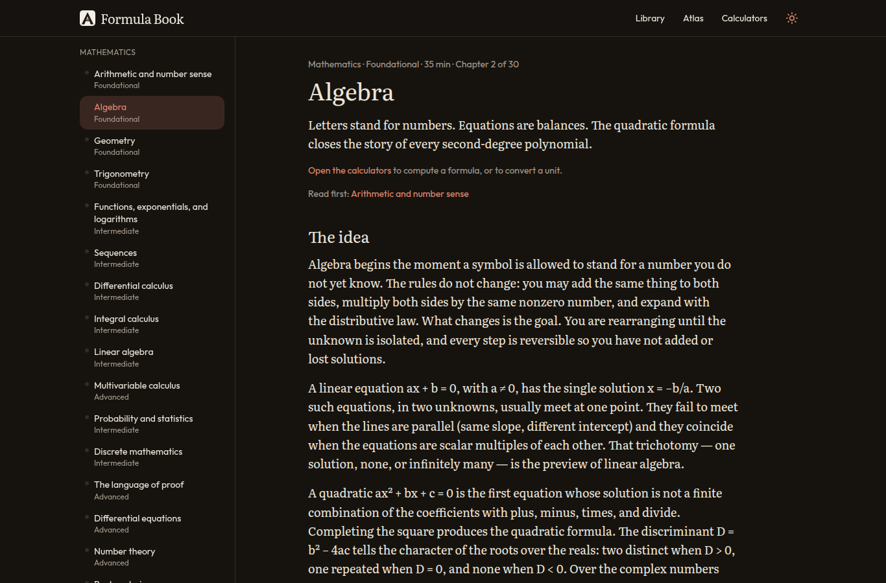
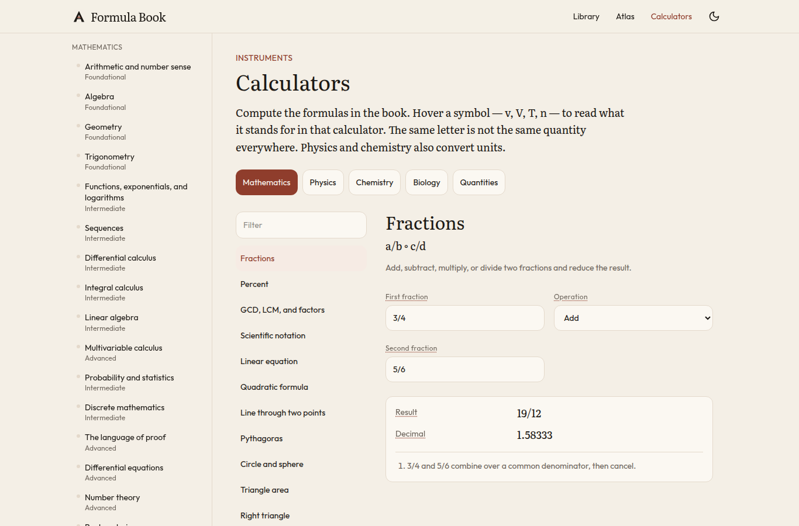
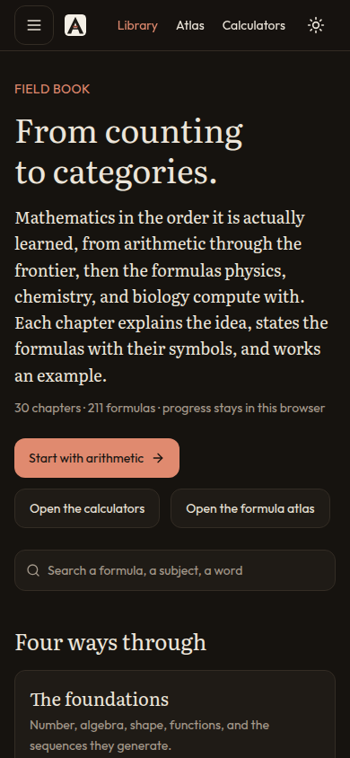

<p align="center">
  
</p>

<h1 align="center">Mathematics, Chemistry &amp; Physics Formula Book</h1>

<p align="center">
  A free, open-source field book of mathematics — from arithmetic to the research frontier — plus the
  formulas of physics, chemistry, and biology, with worked examples and 114 interactive calculators.
</p>

<p align="center">
  <a href="https://garyleebairdjr-cmyk.github.io/mathematics-chemistry-physics-formula-book/"><strong>Open the book →</strong></a>
  &nbsp;·&nbsp;
  <a href="#run-it-yourself">Run it locally</a>
  &nbsp;·&nbsp;
  <a href="CONTRIBUTING.md">Contribute</a>
</p>

---

## What's inside

| | |
|---|---|
| **30 chapters** | 20 of mathematics in the order it is actually learned, then physics, chemistry, and biology |
| **211 formulas** | Typeset with KaTeX — hover any symbol to see what it means *in that formula* |
| **181 worked examples** | Step-by-step, with the answer called out |
| **64 practice problems** | Hidden solutions you can reveal when ready |
| **114 calculators** | Math (28), physics (61), chemistry (20), biology (5), plus a unit converter |
| **Formula atlas** | Every formula in one searchable page, with the physical constants used |

**Mathematics** — Arithmetic · Algebra · Geometry · Trigonometry · Functions, exponentials & logarithms ·
Sequences · Differential calculus · Integral calculus · Linear algebra · Multivariable calculus ·
Probability & statistics · Discrete mathematics · The language of proof · Differential equations ·
Number theory · Real analysis · Complex analysis · Abstract algebra · Topology · The frontier

**Physics** — Classical mechanics · Energy, heat & waves · Electromagnetism & optics · Relativity &
quantum ideas · The named laws

**Chemistry** — Amounts, stoichiometry & gases · Equilibrium, energy & rates · Acids, bases &
electrochemistry

**Biology** — Populations & genetics · Enzymes, membranes & scaling

## Screenshots

| Library | Chapter (dark theme) |
|---|---|
|  |  |
| **Calculators** | **Phone** |
|  |  |

## How to use it

Nothing to install and no account needed — just [open the book](https://garyleebairdjr-cmyk.github.io/mathematics-chemistry-physics-formula-book/).

- **Read in order or jump in.** The library lists every chapter by subject and difficulty
  (Foundational → Intermediate → Advanced → Frontier). "Four ways through" offers ready-made reading paths.
- **Each chapter has the same shape:** the idea in plain language → key points to hold onto →
  formulas (with every symbol defined) → worked examples → practice problems → common mistakes.
- **Hover, tap, or tab to a symbol** in an equation to see what that letter stands for there.
  (V is volume in one chapter and voltage in another.)
- **Search** from the home page finds chapters and formulas by name or idea. The **Atlas** filters all 211 formulas at once.
- **Calculators** compute the book's formulas, show the steps, and convert units
  (length, pressure, energy, temperature, molarity, and more). Chemistry calculators parse formulas like `Ca(OH)2` or `CuSO4·5H2O`.
- **Track progress.** Mark chapters as read; the home page offers to continue where you left off.
  Progress is saved only in your browser — nothing is sent anywhere.
- **Light or dark.** Use the moon/sun button in the header. It follows your system setting by default.
- Works on phones, tablets, and desktops.

## Run it yourself

You need [Node.js](https://nodejs.org/) 20 or newer.

```bash
git clone https://github.com/garyleebairdjr-cmyk/mathematics-chemistry-physics-formula-book.git
cd mathematics-chemistry-physics-formula-book
npm install
npm run dev        # → http://localhost:5173
```

| Command | What it does |
|---|---|
| `npm run dev` | Start the development server with hot reload |
| `npm run build` | Type-check and build the static site into `dist/` |
| `npm run preview` | Serve the built site locally |
| `npm test` | Check every calculator against known answers |
| `npm run lint` | Lint the code |
| `npm run typecheck` | Type-check only |

The result is a fully static site — host `dist/` anywhere (GitHub Pages, Netlify, Cloudflare Pages, a USB stick).
To host under a sub-path, build with `BASE_PATH=/your-path/ npm run build`.

### Deployment

Every push to `main` is linted, tested, built, and published to GitHub Pages by
[`.github/workflows/deploy.yml`](.github/workflows/deploy.yml).

## Project layout

```
src/
  data/            The book itself — chapters, formulas, examples, practice (plain TypeScript)
    types.ts         The Chapter / Formula shapes every chapter follows
    index.ts         Chapter order, reading paths, and constants
  lib/calc/        Calculator engine — one file per subject, plus units and formula parsing
  components/      Page shell, KaTeX rendering, symbol tooltips, calculator bench
  routes/          Pages: library (/), atlas, calculators, read/$slug
tests/             Calculator regression checks
```

Built with [React](https://react.dev), [Vite](https://vite.dev), [TanStack Router](https://tanstack.com/router),
[Tailwind CSS](https://tailwindcss.com), [KaTeX](https://katex.org), and [Zustand](https://zustand.docs.pmnd.rs).

## Contributing

Corrections, clearer explanations, new chapters, and new calculators are all welcome.
Content lives in plain TypeScript files under `src/data/` — no database or CMS — so most contributions are
a single-file edit. See [CONTRIBUTING.md](CONTRIBUTING.md) for how to add a chapter, a formula, or a calculator.

Found a mistake in a formula? [Open an issue](https://github.com/garyleebairdjr-cmyk/mathematics-chemistry-physics-formula-book/issues) — accuracy matters most here.

## License

[MIT](LICENSE) — free to use, copy, adapt, and share, including in classrooms and commercial projects.
